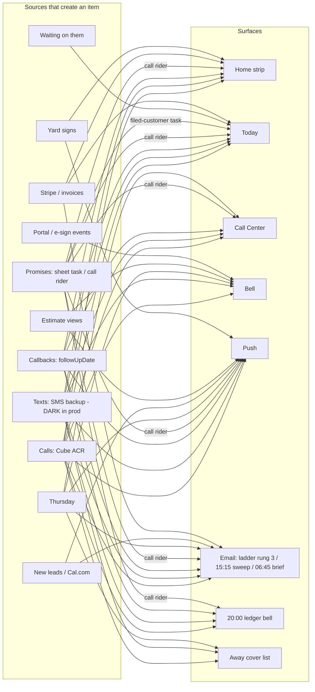

# "Needs you" - lifecycle and volume audit (2026-10-13)

Jo's ask, verbatim: *"We should look into the today and people need you to see
where any breaks / issues / fall off / repetition / spam / etc to make sure it
flows as perfectly as possible and option out / handle flows are build to
their best ability as well."* This note is lane **A** of three: the end-to-end
**lifecycle** and **volume** of "needs you" items. (Lane B walks the phone
click-path of Today; lane C owns the opt-out / handle / snooze / label / away
**controls**. Where a finding below is really a control question it says so.)

Evidence classes, used on every finding:

- **verified (harness)** - reproduced by `tests/needs-you-volume-sim-2026-10-13.test.js`
  against the real server code (callWatch, ladder, ledger, pushUrgent, sweep,
  `callAction`) with a Firestore fake that honours `where()` / `orderBy()` /
  `limit()`, a simulated clock and stubbed senders (nothing is sent).
- **verified (script)** - reproduced by running the real client modules
  (`home-attention.js`, `today-plan.js`) on a built input.
- **read** - found by reading the code, not run. Treat as a lead.

Context read first: [FINDINGS](../qa/never-forget-2026-10-13/FINDINGS.md),
[NEVER-FORGET-RELIABILITY-AUDIT-2026-10-12](NEVER-FORGET-RELIABILITY-AUDIT-2026-10-12.md),
[CONTACT-ROUTING-TREE](../projects/CONTACT-ROUTING-TREE-2026-10-12.md),
[PROMISE-CAPTURE](../projects/PROMISE-CAPTURE-2026-10-12.md),
[NEXT_SESSION-2026-10-13-part2](../projects/NEXT_SESSION-2026-10-13-part2.md),
[server findings](NEVER-FORGET-SERVER-FINDINGS-2026-10-13.md),
[client findings](NEVER-FORGET-CLIENT-FINDINGS-2026-10-13.md).

## 0. The answer in one screen

The call chain (calls, texts, callbacks, the ladder, the ledger) is now tight:
no quiet-hours leaks from callWatch / urgent push / ladder, no ladder overrun
per call, a handled or snoozed item never nags. The weaknesses are at its
**edges**:

| # | Finding | Severity | Status |
|---|---|---|---|
| F1 | **A promise captured through the Handled sheet is a task; nothing server-side tells Jo on its due date.** The call is handled, so callWatch / sweep / brief / ledger / away list all drop it; no function scans task due dates. The 8 pm ledger on the due day reads "0 open". (PROMISE-CAPTURE says "the overdue push already reaches it" - there is no such push.) | **High** | verified (harness: 0 pings, ledger open 0) - options in section 4 |
| F2 | **The email rung never fires when no push can reach a phone** (dead token, notifications off): the rung advances only on a *reached* push, so the email - built for exactly that case - waits behind it forever. Harness: 13 failed push attempts over 2 days, 0 emails; control with a live push: 1. | **High** | verified (harness) - options |
| F3 | A call seen by a run while its transcript was pending ("stored", unknown number) used up its tell id: the transcript's **urgent / promise** was never told and never climbed the ladder. 22 of 280 storm-week calls were seen stored, 10 carried a promise or callback date. | Medium | **fixed here** (test red-first, 3 mutations caught) |
| F4 | **A repeat caller multiplies pings.** One customer, 6 calls in a day (2 urgent): 2 immediate urgent pushes, up to **7 pushes + 4 emails (3 of them ladder emails) to Jo in one day for one person** (design: 3 pushes + 1 email per item). The ladder climbs per *call*, the alert groups per *person*. | Medium | verified (harness) - options |
| F5 | An **urgent call on a customer with no follow-up task** (no promise, no date) is in neither the 06:45 brief nor the 15:15 sweep, yet stays on Home 14 days. The ladder email told Jo "the morning brief lists anything still open". | Medium | verified (harness); email copy fixed here, coverage is an option |
| F6 | **Quiet weeks are not quiet.** A week of 6 calls / 2 texts per day produced a push on **5 of 7 runs every day**; 13 of the 35 were about nothing but an unknown number or a missed call. One unlabeled number that hangs up every 20 min pushed on **every run it was calling (5/day, 15 over 3 days)**. | Medium | verified (harness) - options |
| F7 | The same unchanged open promise is **emailed twice a day** (06:45 brief + 15:15 sweep) for 29 days: 57 emails about one item in 50 days. | Low-Med | verified (harness) |
| F8 | Thursday: her own push + email + SMS go out **at any hour** (22:30 in the sim), and callWatch pings again at the next run for the same call ("not reviewed"). | Low-Med | verified (harness) |
| F9 | Count disagreements: the Home strip counts a person Jo **snoozed** (Today hides them); and a plain Call Center "Handled" drops the person from the strip but leaves the call's follow-up task, so they come back as a **Promised follow-up** on Today. | Medium | verified (script) |

Volume headline (storm week, 40 calls / 20 texts / 12 promises / 5 callbacks /
4 Thursday calls a day, Jo ignoring everything = the ceiling): **19 pushes a
day** (7 callWatch + 8 immediate urgent + 4 Thursday), **16 bells**, **13
emails** (7 of them ladder), and a worst single person at **7 pushes + 5
emails in one day**. With Jo handling each person within ~2 h it is still 18
pushes a day: the volume is new arrivals, not the ladder.

## 1. Lifecycle map

### 1.1 The flow



The line to notice: **"filed-customer task" and "Waiting" reach only Today**
(client). Nothing on the server watches a task's due date (F1).

### 1.2 Source by surface, exits and returns

`R` = reaches the surface. Surfaces: **H**ome strip, **T**oday, **C**all
Center, **B**ell, **P**ush, **E**mail (any rung / brief / sweep), **L**edger,
**A**way list. Exits: **hd** handled, **td** task done, **sz** snooze with a
date, **lb** label hide / quiet, **ag** aged out, **dl** deleted.

| Source | Rule (file) | H | T | C | B | P | E | L | A | Exits | Returns |
|---|---|---|---|---|---|---|---|---|---|---|---|
| Call: urgent | `callNeedsYou` (`call-watch-logic.js:86`, mirror `home-attention.js:177`) | R | R | R | R | R immediate + ladder | R ladder 3 + sweep <36 h *(only with a task, F5)* | R | R | hd, td, sz, lb(hide spam / quiet), ag 14 d | new call from the person, snooze wake, unhandled |
| Call: promise of Jo's | same; `openJoPromise` | R | R | R | R | R | R sweep | R | R | hd, td, sz, kept (nightly cleanup), ag 14 d -> 45 d -> one "old promises" row | due date arrives (`#due`), snooze wake |
| Call: callback date | `followUpDate <= today` | R | R | R | R | R on its day (`#due`) | R sweep when a task exists | R | R | hd, td, sz | each new date |
| Call: unknown number / insurance / missed | `bucket`, `status short` | R | R | R | R | R once (low-value, no ladder) | - | R | R | hd, lb, a later non-missed call from the number | new call |
| Call: **stored, not yet transcribed** | counted as an unknown number | R | R | R | R | R once (`#stored`, F3) | - | R | R | transcript decides | transcript |
| Text day | `phone_text_days` | R | R | R | R | R (no immediate urgent push: up to ~3 h) | R sweep | R | R | hd, td, reopened by a new inbound | new inbound text |
| **Promise task (filed customer, via the sheet)** | `leads/*/tasks/promise-<id>` | - | R | - | R client-derived (app open) | **-** | **-** | **-** | **-** | Kept it, Move | its date (Today only) - **F1** |
| Promise rider (unfiled call) | `call.promise` + `snoozeUntilYmd` | R | R | R | R | R on its day (snooze wake) | R sweep | R | R | Kept it = Handled | date |
| Waiting on them | task `promiseKind:'waiting'` | - | R (own group, not in "N things") | - | R client-derived | **-** | **-** | **-** | **-** | Nudge, Still waiting, Mark dead | ripens by date |
| Thursday call | `thursday_calls` processed, not reviewed | - | - | R (Thursday inbox) | R | R her own + callWatch once | R her own | - | R | reviewed | - |
| New lead | `lead-alert.js` | - | - | - | - | R | R (+ SMS blocked) | - | - | nothing to close; watchdog retries 3x / 6 h | - |
| Estimate viewed | `estimate-view-alert.js` | - | R (Estimates) | - | R (6 h cooldown) | R | - | - | - | - | re-view |
| Invoice overdue | `invoice-overdue.js` | - | R (Money) | - | - | - | - | - | - | task done: **never recreated** | - |
| Stripe to assign | `stripeLedger.needsReview` | R | R (Money, 1 row) | - | - | - | R failed payments (queue) | - | - | assign | - |
| Yard sign | `onYardSignPickupDue` | R | - | - | - | R every morning until picked up | - | - | - | picked up | - |
| Portal / e-sign events | portal.js, esign-* | - | - | - | R (bell only) | - | - | - | - | read | - |
| Pipeline problem | `pipelineProblems`, dead-man | - | R banner | R | R | R (6 h repeat) | Healthchecks | R | - | fixed | - |

### 1.3 Where an item can leave without being handled (fall-off)

| ID | Where | Evidence |
|---|---|---|
| **F1** | Promise task on a filed customer: due date unobserved server-side; ledger "0 open" | verified (harness) |
| F3 | Stored-state tell used up the id | verified, fixed |
| F5 | Urgent, filed, no task: absent from brief / sweep (`call-center-logic.js:565`, `if (task)` / `!c.leadId` only) | verified (harness) |
| D1 | Waiting items: Today only; no push / email / brief | read (no server reader of waiting tasks) |
| D2 | Invoice-overdue task done or deleted: never recreated, so the invoice never reminds again (`invoice-overdue.js:69-71`) | read |
| D3 | Ledger bell is "unread until Jo taps", but the bell reads the newest **50** docs (`crm-snooze.js:83-88`); storm week writes 16 bells/day, so a ledger bell scrolls out in ~3 days | read + harness bell counts |
| D4 | Morning-brief absorb: the 07:15 sweep and the 07:00 lead digest are skipped whenever the brief is *configured*, not when it *sent* (`morning-brief-absorb.js:34-46`); a rejected / no-key brief loses both emails that morning (Healthchecks is the only cover) | read |
| D5 | Home's "old promises" read is `phone_calls` only (`home-attention.js` ~385); the server ledger counts texted old promises, Home does not | read |
| D6 | Calls past 14 days with a follow-up date but no promise and no customer: not alerted | read (client findings agent) |
| D7 | `too_large` and 3-strike transcription failures are never retried or surfaced as a person (only `transcripts_behind` hints) | read |
| D8 | A deleted lead takes its tasks off Today (`byId.get` fails) | read |
| D9 | Unmatched inbound SMS goes to `unmatched_sms` with no owner notification (line is dark: `TWILIO_INBOUND_ENABLED=false`) | read, latent |

### 1.4 Where the same thing appears twice

| ID | Where | Evidence |
|---|---|---|
| R1 | Urgent call: immediate push + bell, then ladder rung 2, rung 3 (+ email), each a *new* bell doc (`call-watch.js` bell per run) | harness (bells 16/day storm) |
| R2 | Thursday call: her push + email (+ SMS) then callWatch "not reviewed" | verified (harness) |
| R3 | Same customer: strip + Today "Calls owed" row + "Money" row + "Waiting" row (`taken` guards only Estimates / Stalled, `today-plan.js:602,656`) | read |
| R4 | A call handled in the Call Center re-appears as a Promised follow-up (its `cube-` task is still due) | verified (script) |
| R5 | A filed promise + an unfiled call from the same number = two rows on the strip (documented as left) | client findings |
| R6 | Two `estimate_viewed` bells (6 h and 30 min cooldowns) per portal open | read |

### 1.5 Where something pings repeatedly

| ID | Where | Numbers |
|---|---|---|
| S1 | callWatch pushes at **every run** that has anything new or a re-tell | storm 7/day; quiet week 5/day (13 of 35 about only unknown / missed) |
| S2 | Immediate urgent push per urgent call, unbounded per person | 2 in a day for one person in the repeat-caller sim; 8/day in the storm week |
| S3 | Ladder emails: one per run that has a rung-3 item | up to 7/day, 46 in the storm week |
| S4 | Unchanged promise in the brief + sweep | 2/day x 29 days |
| S5 | Yard-sign push every morning | by design |
| S6 | Dead-man / pipeline problems | every 6 h, 08-20 only |

## 2. Volume simulation

`tests/needs-you-volume-sim-2026-10-13.test.js` (deterministic, ~16 s, in the
CI node bucket). Scenarios are generated by a seeded PRNG; the clock steps 15
minutes; ingest / transcribe run on the 30-minute ticks (ingest before
transcribe before watch, so ~25% of unknown-bucket calls are seen "stored" by a
run); callWatch at 08:00-20:00 every 2 h; sweep 15:15 (07:15 absorbed, as in
prod: `MORNING_BRIEF_ENABLED` and `MORNING_BRIEF_ABSORB_ENABLED` are both
`true`); brief 06:45. Jo's behaviour: *ignores* (the ceiling), *attentive*
(handles a person 30-110 min after first being told, 08:00-21:00).

| Scenario | Jo | pushes/day max (typ) | by source: watch / urgent / Thursday | bells/day max | emails/day max (ladder) | worst person per day | quiet-hours leaks (push, ladder email) |
|---|---|---|---|---|---|---|---|
| Storm week | ignores | **19** (18) | 7 / 8 / 4 | **16** | **13** (7) | **12** (7 push + 5 email) | 0 callWatch / urgent / ladder; Thursday direct only |
| Storm week | attentive | 19 (18) | 7 / 8 / 4 | 16 | 6 (0) | 5 (3 push + 2 email); p50 1, p95 3 | same |
| Quiet week | ignores | 6 (5) | 5 / 1 / 0 | 7 | 4 (2) | 5; p50 2, p95 4 | 0 |
| One number hangs up every 20 min, 3 days | ignores | 5 | 5 / 0 / 0 | 6 | 2 (1) | the robocaller: **5 pushes in a day**, 15 in 3 days | 0 |
| ...same number labelled spam + hide | ignores | 4 | 4 / 0 / 0 | 5 | 2 (1) | the robocaller: **1 total** (the designed "hidden number is calling a lot" push) | 0 |
| One customer, 6 calls in a day | ignores | 7 (3) | 5 / 2 / 0 | 8 | 4 (3) | **11** (7 push + 4 email) | 0 |
| ...same | attentive | 5 (1) | 3 / 2 / 0 | 6 | 0 | 5 pushes (every new call re-opens the person) | 0 |
| A promise snoozed 3 times, then done | ignores | 1 | 1 / 0 / 0 | 2 | 1 (0) | 2 (one push + one email) | 0 |

Storm week totals (Jo ignoring): 126 pushes, 105 bells, 87 emails (46 ladder)
in 7 days; 79 people still open at the end of the week. Attentive: 124
pushes, 103 bells, 41 emails (0 ladder), 7 open at the end. **The ladder is
not the volume source; arrivals are.**

Other measurements:

- **Open item for 50 days, never handled:** an urgent call on a customer with
  no promise: 3 pushes, 1 ladder email, **0** brief / sweep emails, on Home
  until day 14. A dated promise: 4 pushes, **57 brief + sweep emails over 29
  days**, on Home to day 45, then one "old promises" row. The 20:00 ledger bell
  is written all 50 days.
- **Dead push token** with an urgent call open: 13 push attempts over 2 days,
  15 bells, **0 emails** (live token: 1 email).
- **Night:** urgent calls at 21:10, 23:50 and 03:00 produced **0** pushes
  between 21:00 and 08:00 from callWatch / pushUrgent / the ladder (first push
  at 08:00 ET). Thursday's direct push + email fired at 22:30.
- **Stored-state:** 22 of 280 storm-week calls were seen by a run before their
  transcript; 10 of them carried a promise or callback date.
- **Ladder overrun per call:** none. Every call / text day was pushed at most
  3 times plus a due / wake re-tell. Dedupe failures (the same tell id twice)
  were not observed.

### 2.1 Thresholds worth alarming on (proposed, from the numbers above)

| Signal | Designed ceiling | Observed | Suggested flag |
|---|---|---|---|
| callWatch pushes in a day | 7 (one per run) | 7 in the storm week, 5 in a *quiet* week | a day with **>= 5 watch pushes and < 10 calls** (a quiet day shouldn't buzz five times) |
| pings (push + email) about one person in a day | 4 for one call (3 pushes + 1 email) | 11-12 for a repeat caller | **> 4** |
| immediate urgent pushes for one person in a day | 1 | 2 | **> 1** |
| low-value-only watch pushes (only unknown-number / missed items) | 0 is the goal | 13 of 35 (quiet week), 12 of 15 (hang-up burst) | **> 2 a day** |
| ladder emails in a day | 1 batch | 7 | **> 2** |
| total pushes to Jo's phone in a day (all sources) | none defined | 19 (storm) | **> 12** |

## 3. Findings, ranked

Severity is what Jo loses; confidence is the evidence class from the top of
this note. `file:line` are on `main` at 5f1534a8 unless marked.

| # | Sev | Where | Concrete failing input | Conf. | State |
|---|---|---|---|---|---|
| F1 | **High** | `functions/call-center.js:969-1010` (promise action marks the call handled), `call-watch-logic.js:86`, `call-center-logic.js:552` (sweep skips handled), `call-watch-logic.js` dailyLedger (phone rows only); no scheduled reader of `leads/*/tasks` dueDate | Call from a filed customer; Jo taps Handled, picks "Call back" in 2 days; do not open the app on the due day. Pings 0; ledger "0 open" | harness | **open - options 4.1** |
| F2 | **High** | `call-watch-logic.js:463-475` (`nextLadder`: rung advances only `reached`), `call-watch.js:206-219,223` | Phone token missing / expired, an urgent call open. 13 attempts, 0 emails | harness | **open - options 4.2** |
| F3 | Medium | `call-watch-logic.js:231` (`newNeeds`), `call-watch.js:129` | Unknown-number call ingested at a run tick, transcript 30 min later: urgent after hours / Jo promise never told, no ladder | harness | **fixed** (section 6) |
| F4 | Medium | `call-watch-logic.js:555` (`alertFor` groups per person) vs `:424-475` (ladder ids are `call:<id>`); `call-center.js:329` (`pushUrgent` once per *call*) | One customer, 6 calls (2 urgent, 2 promise, 2 missed) in a day: 2 urgent pushes, 7 pushes + 4 emails (3 ladder) in one day | harness | **open - options 4.3** |
| F5 | Medium | `call-center-logic.js:565-580` (`if (task)` / `!c.leadId` are the only urgent branches) | Urgent call on a filed customer with no promise and no date: never in brief / sweep, open on Home 14 d | harness | open (email copy fixed) - options 4.4 |
| F6 | Medium | `call-watch-logic.js:555` (alert sent when `needs.length`), `HIGH_WHY` only used by the ladder | 3 unknown-number calls a day: a push at 3 of 7 runs; hang-ups every 20 min: a push every run | harness | **open - options 4.5** |
| F7 | Low-Med | `call-center.js:712` + `morning-brief.js:305` | One open dated promise: 2 emails/day for 29 days (57 in 50 days) | harness | open - options 4.6 |
| F8 | Low-Med | `functions/integrations/thursday.js:408-427` (no hour gate), `call-watch-logic.js` thursday block of `newNeeds` | Thursday call at 22:30: push + email + SMS at 22:30; callWatch repeats it at 08:00 | harness | open - options 4.7 |
| F9a | Medium | `home-attention.js:177` (`callNeedsYou` never reads `snoozeUntilYmd` / task snooze) vs `today-plan.js:506,511-515` | Call with a promise, task snoozed 3 days: strip 1 person, Today 0 | script | open (control: lane C) |
| F9b | Medium | `call-center.js:915-918` (plain `handled` sets `handledAtMs` only) vs `today-plan.js` dueTasks | Call Center "Handled" on a call whose `cube-` task is due: strip 0, Today 1 "Promised follow-up" | script | open (control: lane C) |
| D3 | Low-Med | `crm-snooze.js:83-88` newest 50 | Storm week: ledger bell older than ~3 days not visible | read | open |
| D4 | Low-Med | `morning-brief-absorb.js:34-46`, `morning-brief.js` 'rejected' / 'no-key' paths | Brief rejected by Resend: 07:15 sweep skipped, lead digest skipped | read | open |
| D5 | Low | `home-attention.js` old-promise read (`phone_calls` only) | Texted promise past 45 d: ledger counts it, Home chip doesn't (texts dark today) | read | open |
| D1 | Low-Med | no server reader of waiting tasks | Waiting item ripens: Today only | read | open - same family as F1 |
| D10 | Low | `text-inbox.js` (no `pushUrgent` equivalent) | Urgent text: told at the next callWatch after the hourly note (~up to 3 h); texts are dark today | read | open |
| D11 | Low | `review-engine.js:340-362` `addDoc` + feed-based dedupe; `crm-snooze.js` `needs_field` re-created daily; `tasks.js:256-270` overdue notice re-fires for a viewer | bell noise | read | open |

## 4. Options for Jo (each with a recommendation)

### 4.1 F1 - promise tasks have no server-side due-day signal

The decision is *what the server may do* on a promise task's due date.

- **A. One daily server pass over open promise tasks (recommended).** A
  scheduled function (or a section of the 06:45 brief + the 08:00 run) reads
  `collectionGroup('tasks')` where `userId == owner`, `kind == 'promise'`,
  `done == false`, `dueDate <= today`; adds them to the brief's "you said
  you'd" section, to the 20:00 ledger's open count (so it can never say
  "nothing fell through" over an overdue promise), and to one 08:00 push per
  day ("2 promises due today"). Reuses the sweep's open-item shape. One new
  collection-group index (`userId` + `kind` + `dueDate`; `userId` is already a
  single-field collection-group index per the brief's comment).
- **B. Feed the existing ladder.** Treat a due promise task as a synthetic
  needs-you row in `callWatch` (reason "you promised something", id
  `task:<lead>/<id>`), so it gets the same 3 tells + email + sticky push as a
  call. More machinery, best parity; needs the ladder keyed by person (see 4.3)
  first or it multiplies pings.
- **C. Leave the task client-only and say so.** Fix the doc claim only; Jo
  opens Today. Cheapest, and it keeps "Handled + sheet" the one place that can
  silently drop a promise.

Recommendation: **A**, then B later if Jo wants the ladder on promises. The
same pass should cover **Waiting** rows when they ripen.

### 4.2 F2 - the email rung is gated behind a reached push

- **A. Email on the first unreached run (recommended).** When `pushRes.sent
  === 0` and the item is high-value, send the same rung email that run (once
  per item: stamp `emailedAt` in the ladder entry). A dead phone then costs
  one email per item, which is what the rung is for.
- **B. Count an unreached push as a rung** after the second miss
  (`miss >= 2` => rung advances for the email only). Slower, no new state.
- **C. Healthchecks only.** Today's `throw` already fails the heartbeat
  (Healthchecks emails Jo "callWatch failing" every run). Cheap, but it tells
  Jo the *system* is down, not *who* is waiting.

Recommendation: **A**. Not auto-fixed here because it adds an email in a
failure mode and Jo should choose the wording and the once-per-item rule.

### 4.3 F4 - repeat callers multiply pings

- **A. Person-level ladder and urgent collapse (recommended).** Key the ladder
  by `callerKey` (person) with the item list inside; `pushUrgent` stamps a
  per-person `lastUrgentPushAtMs` and, inside 60 minutes, folds the new call
  into one replaced notification ("Pat called again - 2 urgent calls", same
  `notificationId` tag so the lock screen shows one card). Design: one person =
  <= 3 pushes + 1 email a day however many times they ring.
- **B. Collapse only the immediate urgent push** (smallest change, leaves the
  ladder per-call but alerts are already one line per person).
- **C. Leave it.** A caller who rings 6 times is more urgent, not less; accept
  the volume.

Recommendation: **A**, with the new call *raising* the person's urgency (so
the sticky rung is never lost). Also give call-watch pushes a constant
`notificationId` so re-tells replace instead of stacking
(`call-watch.js:248` uses `'call-watch-' + Date.now()`, so every push is a new
card on the lock screen).

### 4.4 F5 - urgent, filed, no task: not in the brief / sweep

- **A. List it (recommended).** In `collectSweepItems`, a call with a
  `leadId`, `urgent` within 36 h, not handled and no task, is an `urgent` item
  (no due). One branch; the brief and sweep then match the ladder's promise.
- **B. Create the follow-up task at transcription** for any urgent call
  (`buildFollowUpTask` returns null with no promise / date today), so every
  other surface that keys on the task (Today, sweep) sees it.
- **C. Leave it** (urgent = push + ladder + Home only) and keep the email copy
  honest, as now.

Recommendation: **B** (a task is the thing Today and the sweep already
understand and the call stays one concept), A as the fallback.

### 4.5 F6 - quiet weeks are not quiet; hang-up bursts push every run

- **A. Low-value-only runs are bell-only (recommended).** A run whose items are
  all "unknown number" / "missed call" (none in `HIGH_WHY`) writes the bell and
  no push; the items ride the next push-worthy run or the 20:00 ledger. In the
  quiet week this removes 13 of 35 pushes; in the hang-up burst 12 of 15.
- **B. Digest low-value items** into one push at 12:00 and one at 18:00.
- **C. Label-driven only:** keep pushing, rely on Jo labelling the number
  (one tap: "spam + hide" cuts 15 pushes to 1).

Recommendation: **A**, plus show a **"Label this number?"** chip on the third
bell for the same unlabeled number in a day (lane C owns the control).

### 4.6 F7 - the same promise, emailed twice a day for a month

- **A. Escalate then quiet (recommended).** List an item in the brief and the
  sweep daily for its first 7 days past due, then fold it into one line
  ("4 older promises still open") and one weekly reminder.
- **B. Drop the 15:15 sweep when the brief is live** and nothing new arrived
  since 06:45.
- **C. Leave it** (it is Jo's list; it is meant to nag).

Recommendation: **A**. Keep the 14/30/45-day windows (the sweep email reads
30 days while Home keeps promises to 45; note both in the email footer).

### 4.7 F8 - Thursday at night and the duplicate

- **A. Mark a Thursday call "told" once her own channels succeed (recommended).**
  callWatch skips a `thursday_calls` row whose `notifyState.push.sentAt` is
  set; it keeps telling the ones where her channels failed (that is the
  failure case worth a second tell).
- **B. Hold her non-urgent push to 08:00** (email stays), keep urgent / new
  lead at any hour (Jo's earlier decision was "urgent after 8 pm: keep
  8 am vs any hour" - still open in the reliability audit section 7).
- **C. Leave it.**

Recommendation: **A**; B is Jo's decision about nights.

## 5. Where the code and the docs disagree (corrected in place)

| Doc says | Code says | Corrected in |
|---|---|---|
| PROMISE-CAPTURE: "the existing task-overdue path already reaches the bell and push" for a promise task | The task-overdue notice is a **client** bell doc (`tasks.js:256-270`); no server function turns it into a push or scans task due dates | dated update at the bottom of [PROMISE-CAPTURE](../projects/PROMISE-CAPTURE-2026-10-12.md) |
| ladder email: "the morning brief lists anything still open"; reliability audit section 6c "push, second push, email, morning brief" | The brief lists sweep items only (a task due, urgent < 36 h with a task, or a no-customer call). An urgent call on a filed customer with no task is absent (F5) | email copy fixed in `functions/call-watch-logic.js`; dated update at the bottom of [the reliability audit](NEVER-FORGET-RELIABILITY-AUDIT-2026-10-12.md) |
| `functions/morning-brief.js` header: "deliberately absent from functions/.env.nobigdeal-pro" | `MORNING_BRIEF_ENABLED=true` and `MORNING_BRIEF_ABSORB_ENABLED=true` are in the file | header comment fixed |
| CLIENT-FINDINGS: open promises past 45 days "come from their own bounded read" (texts counted too, per the server note) | Home's old read is `phone_calls` only; texted old promises are in the server ledger but not on Home (D5) | dated update at the bottom of [the client findings](NEVER-FORGET-CLIENT-FINDINGS-2026-10-13.md) |
| reliability audit section 1 / R8: texts dark | still true: `TEXT_INBOX_ENABLED` / `TEXT_NOTES_ENABLED` absent. Every text finding in this note is **latent** until they are switched on | noted here |
| `callWatch` "8 AM-8 PM" in several headers | `inWatchHours` is hours **8 through 20 inclusive**, i.e. until 20:59 ET; Jo's quiet rule starts 21:00, so they agree, but the headers read as if 20:00 were the last minute | noted here (no change) |

## 6. Fixed in this PR

1. **F3 (stored-state tell).** `newNeeds` gives a call seen while `stored` its
   own tell id (`call:<id>#stored`); when the transcript lands the call is told
   again **only if** it is now high-value (urgent / promise / due / insurance),
   and then seeds the ladder as any first tell does. A transcript that is just
   another unknown number is not told twice; an urgent call already pushed
   immediately is not told twice. Test:
   `tests/needs-you-lifecycle-fixes-2026-10-13.test.js` (3 of 7 checks red on
   `main` - the other 4 are controls that must stay green - and all green after; three mutations - drop the `#stored` id, drop the
   high-value guard, suppress always - each turn a named check red). The
   simulation shows the treated call now follows the control: pushes at
   16:00Z (unknown), then 18:00Z / 20:00Z / 22:00Z (promise, re-tell, last
   rung + email).
2. **F5 copy.** The last-rung email no longer says the brief lists anything
   still open (it points at Today / the Call Center, which do). Test in the
   same file, red first.
3. `pushUrgent` is exported on `call-center.js` `_test` (a test seam, no
   behaviour change); `morning-brief.js` header corrected.

Nothing else was changed: F1, F2, F4-F9 are behaviour decisions (they add or
remove pings) and are Jo's to choose above.

## 7. Not run / unverified

- No emulator, no browser, no production data, no real send (every sender
  stubbed). Volumes are simulated from the *scenario* in section 2, not
  measured from Jo's phone; production arrival rates will differ. The shape
  (one push per run, one ladder per call) is code, not assumption.
- The sim models Jo's handling with two simple policies; a real Jo sits between
  them.
- FCM "accepted" is not "seen": the sim treats `sent >= 1` as reached.
- Texts, away mode and `TWILIO_INBOUND` are dark in prod; their findings
  (D5, D9, D10, the text ladder) are latent.
- Client-side leads marked **read** (D3, D8, D11, R3, R6) were found by an
  exploration pass and spot-checked, not run in a browser.
- Healthchecks.io delivery (F2's cover) is unverified, as in the reliability
  audit.

## Reproduce

```bash
node tests/needs-you-volume-sim-2026-10-13.test.js          # prints the tables above; --table adds JSON
node tests/needs-you-lifecycle-fixes-2026-10-13.test.js     # the fixes, red on main
```

## Update 2026-10-13 (promise channel PR) - F1, F2, F5 fixed

Jo chose option **A** for F1, **A** for F2 and the sweep branch (**A**) for F5.
Built in [PROMISE-CHANNEL-AND-PARKED-RULE-2026-10-13](PROMISE-CHANNEL-AND-PARKED-RULE-2026-10-13.md):
a promise task / ripe Waiting item now has a server channel (one 08:00 push,
brief + sweep + ledger + away list, ladder, fail-closed); a push that reaches no
phone mails Jo once per item; an urgent filed call with no task is listed in the
brief / sweep. Harness: F-PROMISE-TASK-SILENT, F-EMAIL-GATED-ON-PUSH and
F-URGENT-NO-TASK now print RESOLVED. F4 / F6 / F7 / F8 are untouched (another
lane); F9a is fixed by the shared parked rule (a snooze now stamps the call).

Findings print as `! F-... REPRODUCES` while they exist and `RESOLVED` after a
fix; they never fail the run (invariants do: callWatch pushes <= 1 per run,
0 quiet-hours leaks from callWatch / urgent / ladder, no call pushed more than
3 times + due + wake).
